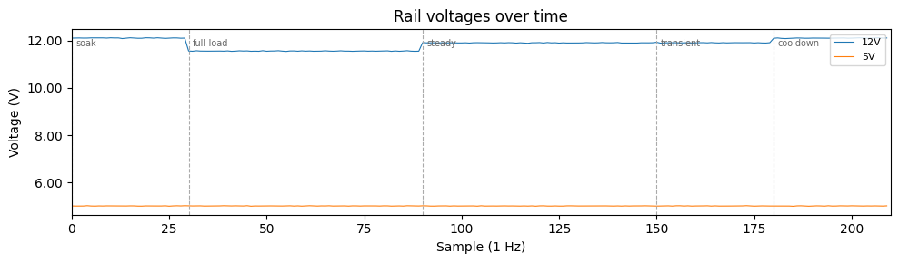
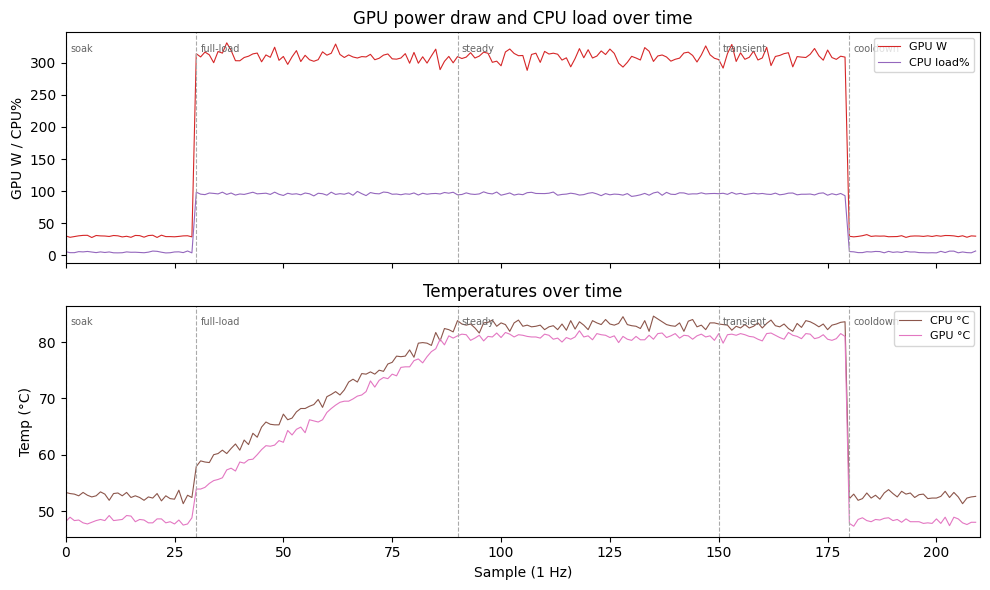

# PSU Test Summary

| Field | Value |
|---|---|
| Verdict | WARN |
| PSU | ExampleCo EX-1000 |
| Wattage | 1000W |
| Serial | SYNTH-0001 |
| Lot | LOT-DEMO |
| Operator | demo |
| Reason | synthetic demo (warn) |
| Started | 2026-01-01T12:00:00+00:00 |
| Ended | 2026-01-01T12:03:30+00:00 |
| Profile | synthetic-demo (0.1) |
| Bench | synthetic-bench |
| Bench last verified | 2026-01-01 |
| Ambient temp | 22.00C |
| Notes |  |
| Claim scope | software-only |
| Coverage confidence | 0.40 |

## Telemetry Readiness

## Coverage Confidence Factors

- -0.30: No multimeter readings were recorded for this run.
- -0.15: NVML telemetry was unavailable, reducing GPU rule coverage.
- -0.10: turbostat was unavailable, reducing CPU telemetry coverage.
- -0.05: STORAGE DUT was disabled for this run.

## Bench Observations

| Check | Result |
|---|---|
| Paperclip test | pass |
| POST with returned PSU | pass |
| Known-good PSU swap performed | no |
| Known-good PSU swap result | not-done |
| Original system retest | not-run |

## Manual Rail Readings

| Reading | Value |
|---|---|
| 12V idle | n/a |
| 12V load | n/a |
| 5V idle | n/a |
| 5V load | n/a |

## Verdict Rationale

- [power] 12V drift reached warning band (12.10V → 11.54V).

## Subsystem Results

| Subsystem | Status | Notes |
|---|---|---|
| power | WARN | 12V drift reached warning band (12.10V → 11.54V). |
| thermal | PASS | none |
| memory | PASS | none |
| storage | PASS | none |
| pcie | PASS | none |

## Defensible Conclusion

This run captured warning-level behavior. Retest with a known-good PSU substitution before making an RMA claim.

## Storage Workload

| Field | Value |
|---|---|
| Phase | cliff-write |
| Classification | cliff stable |
| Cliff ratio | 0.238 |
| Peak 10s avg write BW | 5891355 KiB/s |
| Tail 10s median write BW | 1399527 KiB/s |
| Major drops | 1 |
| Major rises | 0 |
| Tail CV | 0.003 |
| Baseline loaded | no |
| Artifact | `storage\fio\cliff-write\seq_write-nvme0n1\write-cliff-analysis.json` |

One major cliff followed by a relatively stable post-cliff plateau.

## Telemetry Summary

| Metric | Value |
|---|---|
| Samples captured | 210 |
| Events captured | 2 |
| RAM used max | 62.90% |
| Disk busy max | 81.30% |
| SSD temp max | 52.80C |
| HBA count | 0 |
| I2C adapters | 0 |
| I3C buses | 0 |
| 12V min | 11.54V |
| 12V max | 12.11V |
| GPU power max | 330.80W |
| CPU load max | 99.70% |

## Telemetry Charts

## Scope Note

This report is written to preserve only what the run directly supports. Without multimeter
data, the strongest claim is bench isolation by system behavior. With a known-good PSU
swap, the strongest claim is that the observed fault followed the returned PSU on the
bench. Do not claim absolute rail compliance, ripple compliance, or transient-response
compliance unless those were actually measured.

